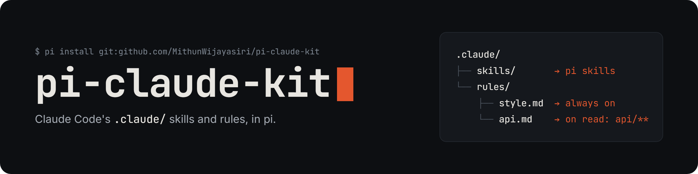

<p align="center">
  
</p>

<p align="center">
Use your repo's <code>.claude/skills</code> and <code>.claude/rules</code> in pi. Rules load the same way they do in Claude Code.
</p>

## Overview

A [pi](https://pi.dev) package that reads Claude Code's project files, so the same `.claude/` setup works in both tools.

- Skills in `.claude/skills/` load as pi skills. The agent reads them like any other pi skill.
- Rules in `.claude/rules/` load the same way as in Claude Code. A rule without `paths:` frontmatter is always on. A rule with `paths:` globs loads into context when the agent reads, edits, or writes a matching file.
- User rules from `~/.claude/rules/` load before project rules.

pi loads `CLAUDE.md` itself, so it needs no setup.

## Install

From GitHub:

```bash
pi install git:github.com/MithunWijayasiri/pi-claude-kit
```

<details>
<summary>Other sources</summary>

From npm, once the package is published:

```bash
pi install npm:pi-claude-kit
```

From a local checkout, while developing:

```bash
pi install ./pi-claude-kit
```

</details>

## The rules model

Each rule is a markdown file in `.claude/rules/` or `~/.claude/rules/`. Its frontmatter sets when it loads:

````markdown
---
paths:
  - "apps/**"
  - "tests/**/*.{ts,tsx}"
---

# Locator rules

Rule content applies only to files matching the globs above.
````

| Rule file | Loads |
|:--|:--|
| No `paths:` frontmatter | Always, inlined into the system prompt every session |
| `paths:` globs | Lazily, appended to the result of the first `read`, `edit`, or `write` of a matching file |

Each lazy rule injects once per session. Compaction and `/tree` branch switches reset this, so the rule injects again on the next matching file. The extension ignores every frontmatter key except `paths:`. Globs match against the path relative to the project root, the same as in Claude Code. `*.md` matches only files in the project root, `**/*.md` matches at any depth, and brace expansion like `*.{ts,tsx}` works.

## How it works

The package is one extension, `extensions/claude-kit.ts`, that hooks these pi events:

1. `resources_discover` adds `<project>/.claude/skills/` to the paths pi searches for skills.
2. `session_start` scans both rules directories and builds the rules section. A malformed `paths:` value throws an error.
3. `before_agent_start` adds always-on rules to the system prompt and lists lazy rules with their globs.
4. `tool_result` appends a lazy rule to the result of a `read`, `edit`, or `write` on a matching file.
5. `session_compact` and `session_tree` clear the record of injected rules.

The project root is the nearest parent directory that contains `.claude` or `.git`. The search stops at your home directory and never uses it as the root. Globs match relative to the project root.

## Limitations

- pi loads `CLAUDE.md` itself and reads one context file per directory. If a directory has both `AGENTS.md` and `CLAUDE.md`, pi loads only `AGENTS.md`. pi doesn't follow `@import` directives and doesn't load `.claude/CLAUDE.md` or `CLAUDE.local.md`.
- The extension loads project skills only, not `~/.claude/skills/`.
- When the agent creates a new file, the rule arrives in the result of that `write`, after the file is written. It applies from the next edit onward.

## License

MIT
